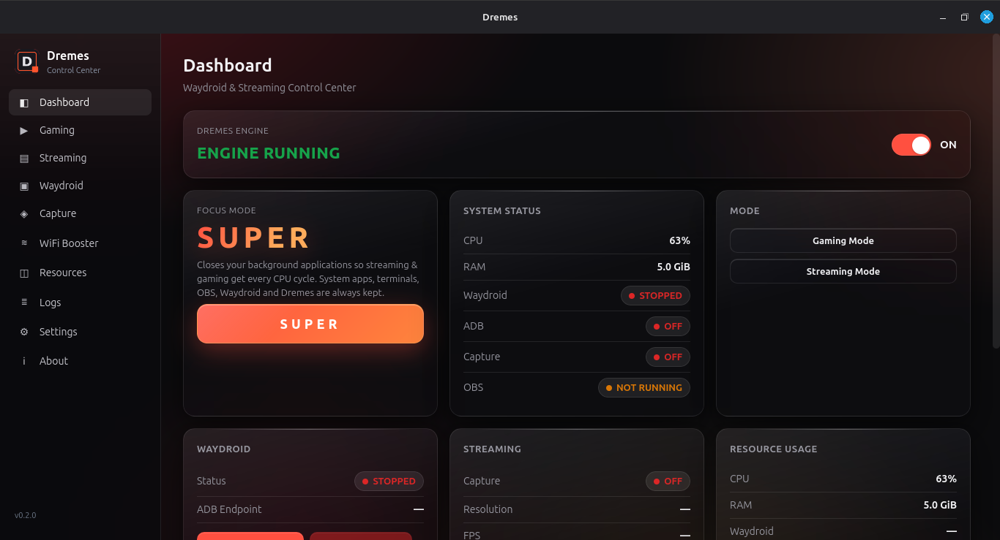
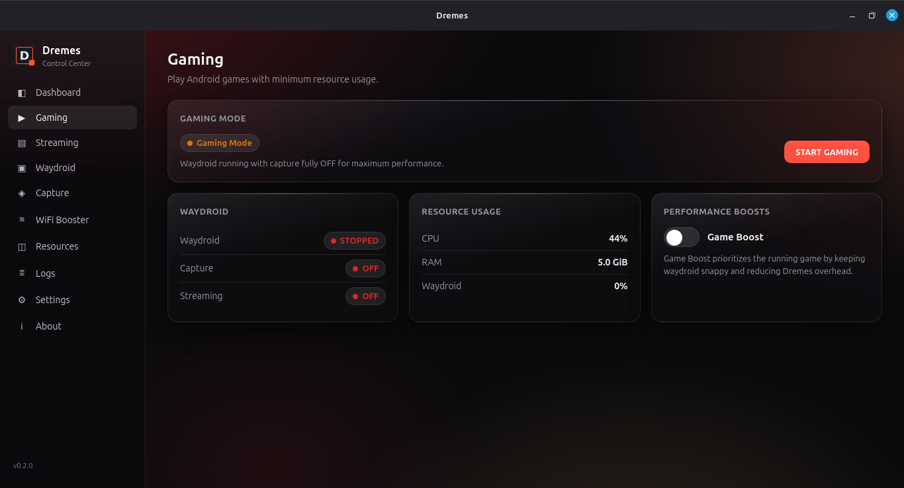
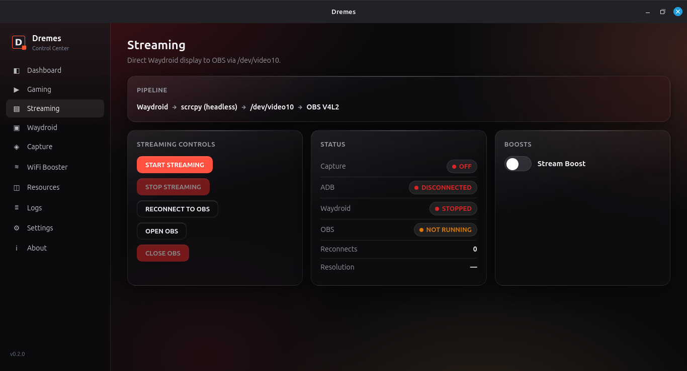
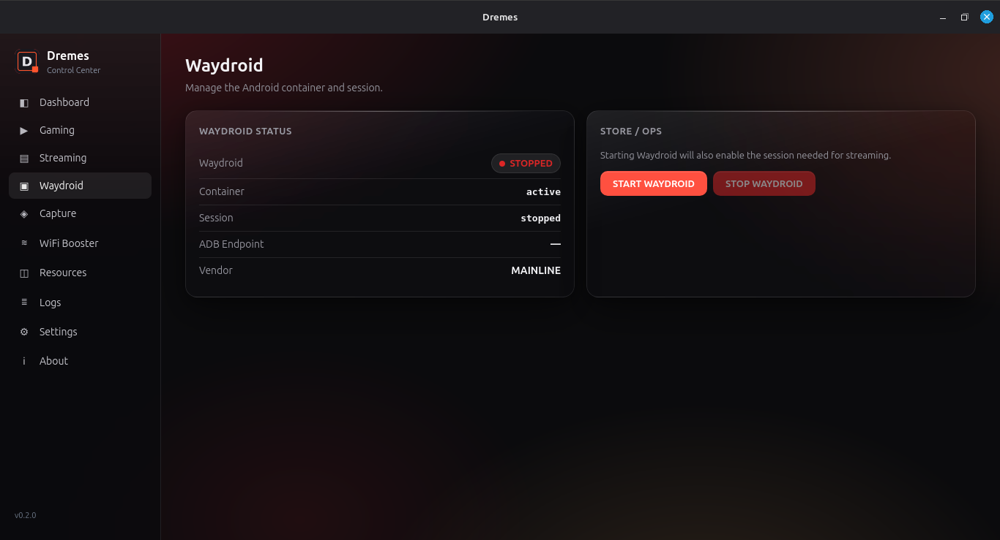
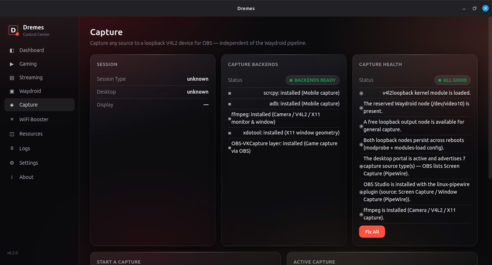
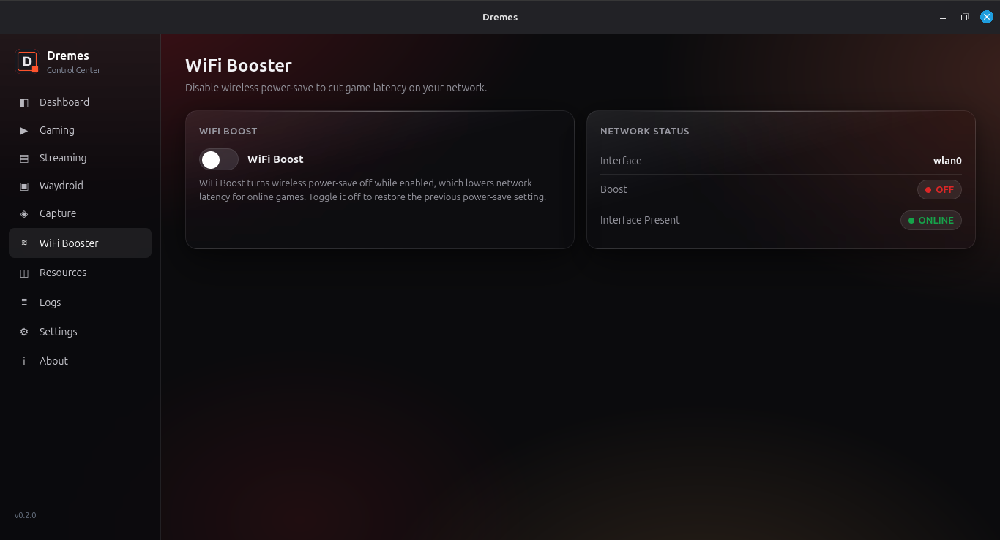
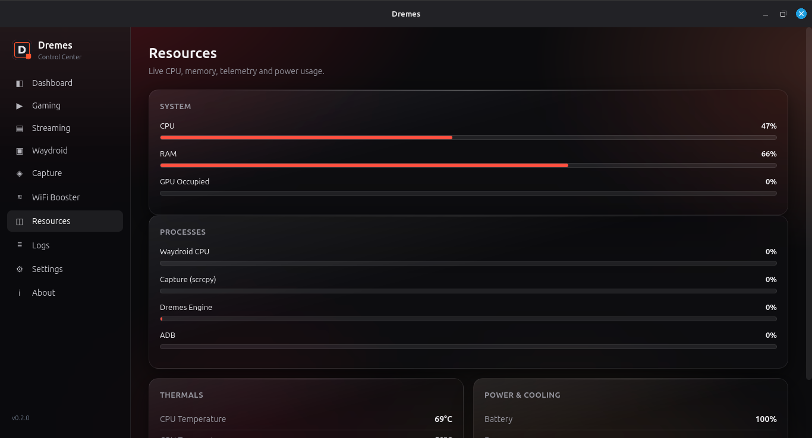
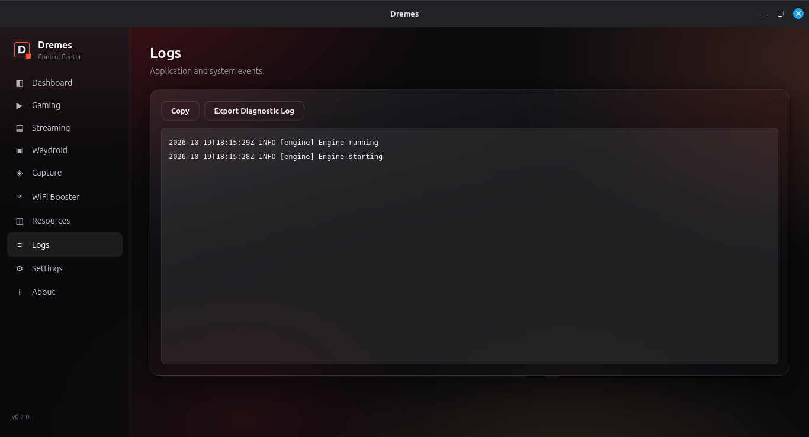

<div align="center">


# Dremes

**Waydroid & Streaming Control Center**

One desktop app to run Android games on Linux and stream them to OBS — with
live monitoring, boosts, and automatic recovery. No more loose scripts.


-black)


</div>

---

Dremes is a cross-platform-designed desktop application that acts as the
single control center for managing **Waydroid, gaming, streaming, capture,
OBS integration, resource usage, and automatic recovery**.

It replaces the pile of temporary Waydroid→OBS service scripts (dummy V4L2
writers, net-fix hacks, capture daemons, watchdogs) with one coherent app:
a **GUI**, a background **Engine**, and one central **state machine**. No
separate scripts fighting over Waydroid, ADB, scrcpy, FFmpeg, or
`/dev/video10` ever again.

## Screenshots

| Dashboard | Gaming |
| --- | --- |
|  |  |
| **Streaming** | **Waydroid** |
|  |  |
| **Capture** | **WiFi Booster** |
|  |  |
| **Resources** | **Logs** |
|  |  |

## Highlights

- **Dashboard** — engine master switch, live system status (CPU / RAM /
  Waydroid / ADB / Capture / OBS) and one-click mode switching.
- **Gaming Mode** — Waydroid with capture fully OFF for maximum performance.
- **Streaming Mode** — direct Waydroid → scrcpy (headless) → `/dev/video10`
  → OBS V4L2 pipeline, with Start/Stop, **Open OBS**, and
  **Reconnect to OBS** recovery.
- **Performance Boosts** — Stream Boost (raises capture priority, never the
  game's cost) and Game Boost (suspends capture while not streaming,
  reduces Dremes' own overhead).
- **SUPER focus mode** — closes background applications so streaming and
  gaming get every CPU cycle. System apps, terminals, OBS, Waydroid and
  Dremes itself are always kept.
- **WiFi Booster** — disables wireless power-save while streaming to cut
  game network latency; toggling off restores the previous setting.
- **General Capture** — capture Mobile (ADB/scrcpy), Game (obs-vkcapture),
  Window, Monitor, or Camera sources into a free V4L2 loopback device for
  OBS, with a live backend/health catalog and a one-click **Fix All**.
- **Resources** — live CPU / RAM / GPU telemetry, per-process usage,
  thermals and battery.
- **Logs** — engine event log with copy and diagnostic export.
- **Settings** — autostart behavior, tray, theme (System/Light/Dark), waydroid
  recovery, capture device/fps/retries, ADB discovery, and signature sounds.

## Architecture

```
                DREMES UI  (Tauri 2 + React/TypeScript)
                    |
              DREMES CORE  (types, state machine, settings, platform abstraction)
                    |
        --------------------------
        |                        |
   Linux Backend           Windows Backend
   (Waydroid, ADB,   (graceful "unavailable" for
    scrcpy, V4L2)          Waydroid features)
```

Two cooperating processes share one codebase:

- **Dremes GUI** — a Tauri window. Displays state and sends *intents* to the
  Engine. It may be closed while the Engine keeps working.
- **Dremes Engine** — a background daemon (`dremes-engine`). It is the single
  owner of the state machine, process registry, and all hardware management.
  GUI ↔ Engine communicate over a Unix domain socket using
  newline-delimited JSON.

### Key invariants

- **Exactly one capture writer** at any time while streaming: a single
  headless `scrcpy --v4l2-sink=/dev/video10`. No dummy writers, no FFmpeg
  contending for the device.
- **Engine OFF by default** after install / reboot. Nothing auto-starts: no
  Waydroid, no scrcpy, no capture.
- **Process ownership**: Dremes terminates only PIDs it started (tracked in
  a registry) *and* whose command line still matches the expected role —
  never a blind `killall`.
- **Dynamic discovery**: no hardcoded Waydroid IP or resolution. The ADB
  endpoint and display resolution are detected at runtime.

### Capture pipeline

```
Waydroid framebuffer
        ↓
headless scrcpy  (--no-window --no-audio --v4l2-sink=/dev/video10)
        ↓
/dev/video10  (V4L2 loopback)
        ↓
OBS  (Video Capture Device source)
```

Only Waydroid content reaches `/dev/video10`. No desktop/monitor/PipeWire
screen capture is involved in the Waydroid pipeline.

### Operating modes

- **Gaming Mode** — Waydroid only; capture/streaming fully OFF.
- **Streaming Mode** — Waydroid + direct capture to OBS.
- **Stop Streaming** — stops capture/scrcpy; keeps Waydroid + game running.
- **Stop Waydroid** — cleans up; uninstalls nothing.
- **Reconnect Waydroid to OBS** — recovery operation; never restarts OBS or
  forces source recreation.

## Install

### From source (Linux)

Prerequisites: `rustc`/`cargo`, `node`/`npm`, the Tauri system deps
(`libwebkit2gtk-4.1-dev`, `librsvg2-dev`, …), and the runtime components:
`waydroid`, `adb`, `scrcpy`, `v4l2loopback-dkms`, `v4l2loopback-utils`, and
optionally `obs-studio`.

```bash
# Backend + engine (Rust)
cargo build --workspace
cargo test --workspace

# GUI (Tauri)
cd apps/gui
npm install
npm run build         # builds dist/
npm run build:tauri   # Tauri release build
```

### Debian package

The repo ships a self-contained packaging script (engine binary built from
source, GUI from the Tauri release build, systemd user unit, desktop entry,
uninstaller):

```bash
./packaging/build-deb.sh
sudo apt install ./target/dremes_0.2.0_amd64.deb
```

After installation the Engine is **OFF**. Opt in explicitly when you want it:

```bash
systemctl --user enable --now dremes-engine.service
```

## Engine state machine

The GUI can be closed at any time — the Engine keeps ownership of capture and
recovery:

- The **Recovery Worker** re-attempts capture when the stream drops
  (configurable retries), unless the master switch is OFF.
- **Auto-recovery of the Waydroid session** can be toggled in Settings.
- All stopped processes are pid + command-line verified; unrelated system
  processes are never touched.

## Troubleshooting

OBS source/portal quirks, v4l2loopback persistence, and `obs-vkcapture`
guidance live in **[docs/TROUBLESHOOTING.md](docs/TROUBLESHOOTING.md)**.

## Repository layout

```
Cargo.toml                 workspace: core + linux-backend + windows-backend + engine
crates/
  core/                    shared types, state machine, settings, platform trait
  linux-backend/           Waydroid, ADB, scrcpy/V4L2, diagnostics, resources
  windows-backend/         graceful unsupported-Waydroid backend
  engine/                  background daemon: state machine + IPC + recovery
apps/gui/                  Tauri 2 + React/TypeScript frontend (src-tauri)
packaging/                 Debian packaging (build-deb.sh, systemd units, desktop entry)
branding/                  logo and assets
docs/                      screenshots + troubleshooting notes
```

## License

Copyright © 2026 **SPOOKEYfr**

This program is free software: you can redistribute it and/or modify it
under the terms of the **GNU General Public License v3.0 or later** — see
[LICENSE](LICENSE).

Any modified version of Dremes must also be released under GPL-3.0-or-later
with full source code.

---

<div align="center">
Built for Linux + Waydroid game streaming · Made with Rust, Tauri, React
</div>
